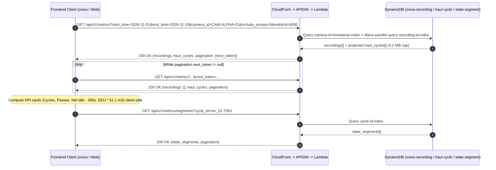

# Ovius Backend REST API & FE–BE Integration Documentation

**Version:** v1 (Production — `ap-southeast-3` Jakarta)  
**Target Clients:** Native macOS SwiftUI + SwiftData client (`ovius`) and web/test clients  
**Architecture Principle:** **Zero-Math Backend Invariant** — All KPI aggregations, payload volume multipliers (`51.1 m³`), stationary idle discounts (`300s`), Z-scores, and shift schedule windows execute strictly on the frontend. The backend filters, projects, and paginates raw telemetry from DynamoDB and orchestrates direct-to-S3 video uploads and GPU inference.

---

## 1. Base URLs, Authentication, CORS & Global Constraints

### 1.1 Base URLs (`ap-southeast-3` Primary)

| Environment / Path | Base URL | Notes |
| :--- | :--- | :--- |
| **CloudFront CDN (Primary)** | `https://d1zj4agypqh81v.cloudfront.net/api/v1` | Distribution `E21IWGD0JCX7OL`; caching disabled (`Managed-CachingDisabled`), forwards all query params & methods (`GET`, `HEAD`, `OPTIONS`, `PUT`, `POST`, `PATCH`, `DELETE`) |
| **Regional API Gateway (Fallback)** | `https://4jg1b9qut2.execute-api.ap-southeast-3.amazonaws.com/v1/api/v1` | REST API `4jg1b9qut2`, Stage `v1`, direct invoke fallback |

### 1.2 Authentication, Headers & CORS
- **Auth Mode:** Currently `AuthType: NONE` (open for integration). The CloudFormation stack supports `RequireApiKey=true`, so clients should optionally accept and forward an `x-api-key` header when configured.
- **Standard Response Headers:**
  - `Content-Type: application/json`
  - `Access-Control-Allow-Origin: *`
  - `Access-Control-Allow-Methods: GET,POST,PUT,OPTIONS`
  - `Access-Control-Allow-Headers: Content-Type,Authorization,x-api-key`
  - `Cache-Control: no-store`
- **Preflight:** Any route responds to `OPTIONS` with HTTP `204 No Content`.

### 1.3 Platform Guards & Hard Limits

| Guard / Limit | Value | Purpose |
| :--- | :--- | :--- |
| **Telemetry Pagination `limit`** | `1 .. 15000` (default `1000`) | Caps items returned per REST page |
| **JSON Response Byte Guard** | `4,200,000` bytes (~4.2 MB) | Prevents API Gateway `6 MB` Lambda payload limit overflow by cutting a page early and returning `next_token` |
| **Upload Session Bounds** | `<= 50` recordings/session, `<= 100` chunks/recording | Bounds single-session transaction & query size |
| **S3 Multipart Part Size** | Minimum **`5 MiB`** (`5,242,880` bytes) for all parts except the final part | Enforced by S3 `CompleteMultipartUpload` (`EntityTooSmall` otherwise) |
| **Pre-Signed URL Lifetimes** | Upload parts: `60..1800s` (default `1800s`)<br>Playback/Parquet (`GET`): `3600s` | Mitigates Lambda STS temporary credential expiry mid-upload |

---

## 2. Proposed FE–BE Integration Flows

### Flow A — Dashboard Telemetry & 3-Layer Data Explorer Read Flow

1. **Cluster & Section Resolution (Client Side):** The frontend maintains local organizational groupings (`Cluster` / `Section` in SwiftData) mapped via `camera_id`, `location_tag`, `tag`, or `filename` selectors.
2. **Initial Dashboard Load (`GET /api/v1/metrics`):**
   - Request with `start_time` & `end_time` (ISO-8601 UTC or `YYYY-MM-DD`), optional `camera_id` (comma-separated or `*`), and **`include_scoops=false`** + **`include_segments=false`** for fast KPI loading without nested arrays.
   - Page `1` returns matching `recordings[]` plus the first slice of `haul_cycles[]` and an opaque base64 `pagination.next_token` if more items or bytes remain.
   - Loop `GET /api/v1/metrics?...&next_token=<token>` until `pagination.next_token == null` (`recordings` is `[]` on pages 2+).
3. **Cache Per Immutable Recording:** Cache each recording's cycles locally (e.g., LZFSE disk cache) keyed by `recording_id`. Recordings are **guaranteed immutable** once visible in `/metrics/recordings` because the backend only writes `ovius-recording` after all inference completes.
4. **3-Layer Data Explorer Drill-Down:**
   - **Layer 1 (Recordings):** Loaded from `/metrics` or `GET /api/v1/metrics/recordings`.
   - **Layer 2 (Haul Cycles for Recording):** `GET /api/v1/metrics/cycles?recording_id={id}&include_scoops=true&limit=1000`.
   - **Layer 3 (State Timings for Cycle):** `GET /api/v1/metrics/segments?cycle_id={cycle_id}&limit=1000` (uses sparse `cycle-id-index`).



---

### Flow B — Multi-Recording Chunked Upload, Live Ingestion & Auto-Wake Flow

The backend is **chunk-duration agnostic**: clients can split a video into arbitrary numbers of sequential `.mp4` chunks (e.g., 1-hour segments in production or `N` equal chunks for testing). Video bytes **never traverse API Gateway** (`10 MB` cap).

```mermaid
sequenceDiagram
    autonumber
    participant FE as Frontend Client
    participant API as Ovius REST API (/api/v1/uploads/*)
    participant S3 as S3 Bucket (ovius-pipeline-apse3-610331148578)
    participant SQS as SQS (ovius-ready-recordings)
    participant EC2 as GPU Worker (g5.xlarge i-05dab2fadd5f3a113)
    participant DDB as DynamoDB (Ingest & Telemetry)

    FE->>API: POST /uploads/sessions (site_id, recordings[], chunks[])
    API->>DDB: Conditionally put META (409 on duplicate) + batch_write REC# & CHUNK# (GSI_ACTIVE_UPLOADS)
    API-->>FE: 201 Created {upload_id, recordings[]}

    loop For each chunk in recording
        FE->>API: POST /uploads/chunks/presign {upload_id, recording_id, chunk_index, part_numbers, s3_upload_id?}
        API-->>FE: 200 OK {s3_upload_id, presigned_parts: [{part_number, url}]}
        loop Each >=5 MiB part (parallelizable)
            FE->>S3: PUT <presigned_part_url> (raw bytes)
            S3-->>FE: 200 OK (capture ETag response header!)
            opt Every 30s during long uploads
                FE->>API: PUT /uploads/sessions/{upload_id}/heartbeat {smoothed_upload_bps, recordings[]}
            end
        end
        FE->>API: POST /uploads/chunks/complete {upload_id, recording_id, chunk_index, s3_upload_id, parts}
        API->>S3: CompleteMultipartUpload
        API->>DDB: TransactWriteItems(CHUNK=UPLOADED, +1 uploaded_chunks) + atomic UPLOADING->READY
        opt Final chunk transitions UPLOADING -> READY
            API->>SQS: SendMessage {upload_id, recording_id}
            API->>EC2: ec2.start_instances (if stopped; else 5m watchdog handles stopping/capacity)
        end
        API-->>FE: 200 OK {upload_status, transitioned_to_ready, worker_lock}
    end

    loop Poll every 3-5s until session_status is terminal
        FE->>API: GET /uploads/sessions/{upload_id}
        API-->>FE: 200 OK {session_status, worker_status, worker_instance_state, recordings[]}
    end

    Note over EC2: Mounts 229GB NVMe /mnt/scratch, ETag hot-syncs S-v5-XL TensorRT, streams frame %/RTF/ETA, publishes child tables -> ovius-recording LAST, auto-stops to stopped ($0/hr)
    FE->>API: GET /metrics/cycles?recording_id=... & GET /metrics/segments?recording_id=... & GET /videos & GET /bboxes
    API-->>FE: 200 OK (streamed raw telemetry + "ready" pre-signed URLs)
```

---

### Flow C — Multi-Chunk Video Scrubbing & Bounding-Box Overlay Playback

1. Call `GET /api/v1/videos?recording_id={id}`. Inspect `status`:
   - `"ready"`: `items[0].chunks[]` contains ordered chunk objects with `start_offset_s`, `duration_s`, and a **GET-only** `presigned_url` (`ExpiresIn=3600s`).
   - `"template"`: Legacy seeded item with no backing S3 MP4 yet (`signed_cookies_required: true`, `chunks: []`).
2. When a user clicks an event at offset `t_offset_s` (for example `t_load_start_s = 14820.0`):
   - Find the chunk `c` in `chunks[]` where `c.start_offset_s <= t_offset_s < c.start_offset_s + c.duration_s`.
   - Seek inside `c.presigned_url` to local time `t_local = t_offset_s - c.start_offset_s`.
3. Call `GET /api/v1/bboxes?recording_id={id}` to retrieve `items[0].presigned_url` (or `chunk_parquet_uris[].presigned_url`) to download the Snappy-compressed detection/tracking Parquet file via HTTP `GET`.

---

## 3. REST Endpoint Reference

### 3.1 Query Parameters Shared by Telemetry Read Endpoints (`GET /metrics*`, `/videos`, `/bboxes`)

| Parameter | Type | Default | Description & Validation Rules |
| :--- | :--- | :--- | :--- |
| `start_time` | `string` | `now - 7 days` (UTC `00:00:00+00:00`) | Lower bound on `recording.timestamp` (`YYYY-MM-DD` or ISO-8601). Ignored by default if `recording_id` or `cycle_id` is supplied without dates. |
| `end_time` | `string` | `now` (UTC `23:59:59+00:00`) | Upper bound on `recording.timestamp` (`YYYY-MM-DD` expands to `23:59:59+00:00`; ISO-8601). Must be `>= start_time`. |
| `start_date`, `end_date` | `string` | `null` | **Fallback aliases** accepted when `start_time`/`end_time` are omitted. Prefer `start_time`/`end_time` for new clients. |
| `camera_id` | `string` | `*` | Single ID (`CAM-ALPHA-01`), comma-separated list, multi-value query params, or `*` for all cameras. Uses GSI `camera-id-timestamp-index` when specified. |
| `recording_id` | `string` | `null` | One or comma-separated recording IDs (`BatchGetItem` fast path). |
| `location_tag` | `string` | `null` | One or comma-separated exact `location_tag` filters. |
| `tag` | `string` | `null` | One or comma-separated tag filters (matches recordings containing **any** specified tag). |
| `filename` | `string` | `null` | One or comma-separated exact `filename` filters. |
| `excavator_id` | `string` | `null` | Filters cycles to one excavator (routes to `recording-excavator-index` GSI). |
| `cycle_id` | `string` | `null` | Supported on `/metrics/segments` to query one haul cycle directly via `cycle-id-index`. |
| `state` | `string` | `null` | Comma-separated state names on `/metrics/segments` (e.g., `idle,loading_scoop`). |
| `tod_start_s` | `number` | `0.0` | Minimum relative offset in seconds (`>= 0.0`) on child cycle/segment range keys. |
| `tod_end_s` | `number` | `43200.0` | Maximum relative offset in seconds (`>= tod_start_s`). |
| `include_scoops` | `boolean` | `true` | `false` activates `CYCLE_SUMMARY_PROJECTION` (omits `scoops` and `truck_segments`) for lightweight dashboard loads. |
| `include_segments` | `boolean` | `false` | `true` includes `state_segments[]` inside `GET /metrics` responses (paginates `cycles` then `segments`). |
| `limit` | `integer` | `1000` | Page item limit (`1 .. 15000`). Responses may still return fewer items if the `4.2 MB` JSON guard triggers. |
| `next_token` | `string` | `null` | Opaque URL-safe base64 pagination cursor (losslessly preserves DynamoDB `Decimal` keys). |

---

### 3.2 Telemetry Read Endpoints

#### 1. `GET /api/v1/metrics` — Composite Raw Telemetry Bundle
Returns matched `recordings[]`, paginated `haul_cycles[]`, and optional `state_segments[]` (`include_segments=true`) in one round-trip.

**Example Request:**
```bash
curl -s "https://d1zj4agypqh81v.cloudfront.net/api/v1/metrics?start_time=2026-11-19&end_time=2026-11-19&camera_id=CAM-E2E-06&include_scoops=false&limit=500"
```

**Response (`200 OK`):**
```json
{
  "query_type": "metrics",
  "filters": {
    "start_time": "2026-11-19T00:00:00+00:00",
    "end_time": "2026-11-19T23:59:59+00:00",
    "camera_id": ["CAM-E2E-06"],
    "recording_id": null,
    "location_tag": null,
    "tag": null,
    "filename": null,
    "state": null,
    "cycle_id": null,
    "excavator_id": null,
    "tod_start_s": 0.0,
    "tod_end_s": 43200.0,
    "include_scoops": false,
    "limit": 500
  },
  "recordings": [
    {
      "recording_id": "rec_e2e_s6_bc4c8b",
      "camera_id": "CAM-E2E-06",
      "filename": "mock_sample_6_e2e.mp4",
      "location_tag": "Zone North",
      "tags": ["e2e-audit", "s6"],
      "timestamp": "2026-11-19T07:00:00+00:00",
      "duration_s": 127.0,
      "fps": 9.749,
      "resolution": "1920x1080",
      "chunk_keys": [
        { "chunk_index": 0, "s3_key": "uploads/open_pit_mine_01/upl_e2e_7f5828b6/rec_e2e_s6_bc4c8b/chunk_00.mp4", "start_offset_s": 0, "duration_s": 62.5 },
        { "chunk_index": 1, "s3_key": "uploads/open_pit_mine_01/upl_e2e_7f5828b6/rec_e2e_s6_bc4c8b/chunk_01.mp4", "start_offset_s": 62.3, "duration_s": 64.7 }
      ],
      "parquet_keys": [
        "parquet/year=2026/month=11/day=19/zone=CAM-E2E-06/rec_e2e_s6_bc4c8b_chunk_00.parquet"
      ]
    }
  ],
  "haul_cycles": [
    {
      "recording_id": "rec_e2e_s6_bc4c8b",
      "cycle_id": "rec_e2e_s6_bc4c8b-c001",
      "excavator_id": "EX-1",
      "excavator_sort_key": "EX-1#000018000",
      "truck_label": "DT-4",
      "cycle_status": "complete",
      "t_arrive_s": 12.1,
      "t_spot_s": 15.0,
      "t_load_start_s": 18.0,
      "t_load_end_s": 54.0,
      "t_depart_s": 59.5,
      "queue_time_s": 2.9
    }
  ],
  "state_segments": [],
  "pagination": {
    "recordings_count": 1,
    "haul_cycles_count": 1,
    "state_segments_count": 0,
    "matched_recordings": 1,
    "next_token": null
  }
}
```
*(Note: On subsequent pages requested with `next_token`, `"recordings"` is returned as `[]` so recording metadata is not duplicated across pages.)*

---

#### 2. `GET /api/v1/metrics/recordings` — Paginated Recordings List
Returns raw `Recording` objects matching date, camera, or tag selectors.

**Example Request:**
```bash
curl -s "https://d1zj4agypqh81v.cloudfront.net/api/v1/metrics/recordings?start_time=2026-11-19&end_time=2026-11-19&limit=50"
```

**Response (`200 OK`):**
```json
{
  "query_type": "recordings",
  "filters": { "...": "..." },
  "recordings": [ { "recording_id": "rec_e2e_s6_bc4c8b", "...": "..." } ],
  "pagination": {
    "count": 1,
    "total_matched_recordings": 1,
    "next_token": null
  }
}
```

---

#### 3. `GET /api/v1/metrics/cycles` — Paginated Haul Cycles
Returns wave-parallel paginated `HaulCycle` items (including embedded `scoops[]` and `truck_segments[]` unless `include_scoops=false`).

**Example Request:**
```bash
curl -s "https://d1zj4agypqh81v.cloudfront.net/api/v1/metrics/cycles?recording_id=rec_e2e_82e05ea8&limit=500"
```

**Response (`200 OK`):**
```json
{
  "query_type": "cycles",
  "filters": { "...": "..." },
  "haul_cycles": [
    {
      "recording_id": "rec_e2e_82e05ea8",
      "cycle_id": "rec_e2e_82e05ea8-c001",
      "excavator_id": "EX-1",
      "excavator_sort_key": "EX-1#000042000",
      "truck_label": "DT-2",
      "cycle_status": "complete",
      "uncertain": false,
      "t_arrive_s": 30.0,
      "t_spot_s": 36.2,
      "t_load_start_s": 42.0,
      "t_load_end_s": 168.5,
      "t_depart_s": 175.0,
      "queue_time_s": 6.2,
      "scoops": [
        {
          "scoop_number": 1,
          "excavator_segment_id": "rec_e2e_82e05ea8#EX-1#000042000",
          "start_s": 42.0,
          "dump_s": 54.0,
          "end_s": 60.0
        }
      ],
      "truck_segments": ["rec_e2e_82e05ea8#DT-2#000030000"]
    }
  ],
  "pagination": {
    "count": 1,
    "matched_recordings": 1,
    "next_token": null
  }
}
```

---

#### 4. `GET /api/v1/metrics/segments` — Paginated Machine State Segments
Query either by `cycle_id` (fast GSI `cycle-id-index`, no date filter needed) or by `recording_id` / date / camera / `state` filters.

**Example Request:**
```bash
curl -s "https://d1zj4agypqh81v.cloudfront.net/api/v1/metrics/segments?recording_id=rec_e2e_s6_bc4c8b&state=idle,loading_scoop&limit=1000"
```

**Response (`200 OK`):**
```json
{
  "query_type": "segments",
  "filters": { "...": "..." },
  "state_segments": [
    {
      "segment_id": "rec_e2e_s6_bc4c8b#EX-1#000018000",
      "recording_id": "rec_e2e_s6_bc4c8b",
      "cycle_id": "NONE",
      "machine_id": "EX-1",
      "machine_type": "excavator",
      "state": "idle",
      "start_s": 0.0,
      "end_s": 18.0,
      "duration_s": 18.0,
      "confidence": 0.91,
      "uncertain": false
    }
  ],
  "pagination": {
    "count": 1,
    "matched_recordings": 1,
    "next_token": null
  }
}
```
*(When queried strictly by `cycle_id`, `pagination` omits `matched_recordings` and returns `{"count", "next_token"}`.)*

---

#### 5. `GET /api/v1/videos` — Multi-Chunk Pre-Signed Video Manifest
Returns ordered video chunk URLs for multi-segment playback & timestamp scrubbing.

**Example Request:**
```bash
curl -s "https://d1zj4agypqh81v.cloudfront.net/api/v1/videos?recording_id=rec_e2e_s7_bc4c8b"
```

**Response (`200 OK`):**
```json
{
  "filters": { "...": "..." },
  "query_type": "videos",
  "status": "ready",
  "items": [
    {
      "recording_id": "rec_e2e_s7_bc4c8b",
      "camera_id": "CAM-E2E-07",
      "filename": "mock_sample_7_e2e.mp4",
      "timestamp": "2026-11-19T07:30:00+00:00",
      "duration_s": 123.82,
      "fps": 9.999,
      "resolution": "1280x720",
      "stream_url": "/videos/CAM-E2E-07/mock_sample_7_e2e.mp4",
      "signed_cookies_required": false,
      "chunks": [
        {
          "chunk_index": 0,
          "s3_key": "uploads/open_pit_mine_01/upl_e2e_7f5828b6/rec_e2e_s7_bc4c8b/chunk_00.mp4",
          "start_offset_s": 0,
          "duration_s": 61.416,
          "presigned_url": "https://ovius-pipeline-apse3-610331148578.s3.ap-southeast-3.amazonaws.com/..."
        },
        {
          "chunk_index": 1,
          "s3_key": "uploads/open_pit_mine_01/upl_e2e_7f5828b6/rec_e2e_s7_bc4c8b/chunk_01.mp4",
          "start_offset_s": 61.4,
          "duration_s": 62.4,
          "presigned_url": "https://ovius-pipeline-apse3-610331148578.s3.ap-southeast-3.amazonaws.com/..."
        }
      ]
    }
  ],
  "pagination": { "count": 1, "total_matched_recordings": 1, "next_token": null }
}
```
> **Note on `status` and `presigned_url`:**
> - `"status": "ready"` indicates at least one item has live pre-signed S3 chunks (`signed_cookies_required: false`). Legacy seeded items without uploaded MP4s return `"status": "template"` with `chunks: []`.
> - All `presigned_url` values are signed strictly for HTTP **`GET`** (`ExpiresIn=3600`). Do not send `HEAD` requests against them.

---

#### 6. `GET /api/v1/bboxes` — Pre-Signed Snappy Parquet Bounding-Box Tracks
Returns S3 Parquet URIs and **GET-only** `3600s` pre-signed URLs containing per-frame tracked bounding boxes.

**Example Request:**
```bash
curl -s "https://d1zj4agypqh81v.cloudfront.net/api/v1/bboxes?recording_id=rec_e2e_s7_bc4c8b"
```

**Response (`200 OK`):**
```json
{
  "filters": { "...": "..." },
  "query_type": "bboxes",
  "status": "ready",
  "items": [
    {
      "recording_id": "rec_e2e_s7_bc4c8b",
      "camera_id": "CAM-E2E-07",
      "timestamp": "2026-11-19T07:30:00+00:00",
      "bbox_artifact_uri": "s3://ovius-pipeline-apse3-610331148578/parquet/year=2026/month=11/day=19/zone=CAM-E2E-07/rec_e2e_s7_bc4c8b_chunk_00.parquet",
      "presigned_url": "https://ovius-pipeline-apse3-610331148578.s3.ap-southeast-3.amazonaws.com/parquet/...",
      "chunk_parquet_uris": [
        {
          "chunk_index": 0,
          "s3_key": "parquet/year=2026/month=11/day=19/zone=CAM-E2E-07/rec_e2e_s7_bc4c8b_chunk_00.parquet",
          "bbox_artifact_uri": "s3://ovius-pipeline-apse3-610331148578/parquet/year=2026/month=11/day=19/zone=CAM-E2E-07/rec_e2e_s7_bc4c8b_chunk_00.parquet",
          "presigned_url": "https://ovius-pipeline-apse3-610331148578.s3.ap-southeast-3.amazonaws.com/parquet/..."
        }
      ]
    }
  ],
  "pagination": { "count": 1, "total_matched_recordings": 1, "next_token": null }
}
```

---

### 3.3 Upload & Ingestion Control Endpoints

#### 7. `POST /api/v1/uploads/sessions` — Register Upload Session & Chunk Manifest
Registers up to `50` recordings and `100` chunks per recording in `ovius-ingest-state`, normalizing timestamps to canonical UTC `+00:00`.

- **ID Validation (`site_id`, `upload_id`, `recording_id`, `camera_id`):** Must match `^[A-Za-z0-9._-]{2,128}$`. (`upload_id` and `site_id` are optional; default `site_id = "open_pit_mine_01"`, auto-generated `upload_id = "upl_<16-hex>"`.)
- **Duplicate Protection:** If a supplied `upload_id` already exists in `ovius-ingest-state`, returns **`409 Conflict`**.

**Request Body:**
```json
{
  "upload_id": "upl_20261119_shift1",
  "site_id": "open_pit_mine_01",
  "recordings": [
    {
      "recording_id": "rec_alpha_20261119_01",
      "camera_id": "CAM-ALPHA-01",
      "location_tag": "Section Alpha - Wide Overview Bench",
      "filename": "alpha_morning.mp4",
      "tags": ["shift:day", "pit:north"],
      "timestamp": "2026-11-19T14:00:00+07:00",
      "duration_s": 7200.0,
      "fps": 25.0,
      "resolution": "1920x1080",
      "chunks": [
        { "chunk_index": 0, "start_offset_s": 0.0, "duration_s": 3600.0, "byte_size": 52428800 },
        { "chunk_index": 1, "start_offset_s": 3600.0, "duration_s": 3600.0, "byte_size": 52428800 }
      ]
    }
  ]
}
```

**Response (`201 Created`):**
```json
{
  "upload_id": "upl_20261119_shift1",
  "site_id": "open_pit_mine_01",
  "session_status": "UPLOADING",
  "s3_bucket": "ovius-pipeline-apse3-610331148578",
  "total_recordings": 1,
  "recordings": [
    {
      "recording_id": "rec_alpha_20261119_01",
      "camera_id": "CAM-ALPHA-01",
      "upload_status": "UPLOADING",
      "expected_chunks": 2,
      "total_bytes": 104857600,
      "chunks": [
        {
          "chunk_index": 0,
          "s3_key": "uploads/open_pit_mine_01/upl_20261119_shift1/rec_alpha_20261119_01/chunk_00.mp4",
          "start_offset_s": 0.0,
          "duration_s": 3600.0,
          "byte_size": 52428800,
          "upload_status": "PENDING"
        },
        {
          "chunk_index": 1,
          "s3_key": "uploads/open_pit_mine_01/upl_20261119_shift1/rec_alpha_20261119_01/chunk_01.mp4",
          "start_offset_s": 3600.0,
          "duration_s": 3600.0,
          "byte_size": 52428800,
          "upload_status": "PENDING"
        }
      ]
    }
  ]
}
```

**Error Responses:**
- `400 Bad Request`: Missing/invalid fields, invalid ISO-8601 `timestamp`, `> 50` recordings, `> 100` chunks, duplicate `recording_id` or `chunk_index`.
- `409 Conflict`: `{"error": "Conflict", "message": "Upload session <upload_id> already exists"}`.

---

#### 8. `POST /api/v1/uploads/chunks/presign` — Lazy / Resumable Part Pre-Signing
Lazily creates an S3 Multipart Upload on first call (or reuses the stored `s3_upload_id` if already started) and mints `PUT` pre-signed URLs for the requested `part_numbers` (`1..10000`, `expires_in` `60..1800`, default `1800`). Safe for resuming after `403 ExpiredToken` on slow links without re-uploading completed parts.

**Request Body:**
```json
{
  "upload_id": "upl_20261119_shift1",
  "recording_id": "rec_alpha_20261119_01",
  "chunk_index": 0,
  "part_numbers": [1, 2, 3],
  "s3_upload_id": null,
  "expires_in": 1800
}
```

**Response (`200 OK`):**
```json
{
  "upload_id": "upl_20261119_shift1",
  "recording_id": "rec_alpha_20261119_01",
  "chunk_index": 0,
  "s3_bucket": "ovius-pipeline-apse3-610331148578",
  "s3_key": "uploads/open_pit_mine_01/upl_20261119_shift1/rec_alpha_20261119_01/chunk_00.mp4",
  "s3_upload_id": "mpu_abc123...",
  "expires_in": 1800,
  "presigned_parts": [
    { "part_number": 1, "url": "https://ovius-pipeline-apse3-610331148578.s3.ap-southeast-3.amazonaws.com/...?partNumber=1&..." },
    { "part_number": 2, "url": "https://..." },
    { "part_number": 3, "url": "https://..." }
  ]
}
```

> **Client Upload Step:** Send HTTP `PUT` with raw bytes to each `url` (`Content-Type: application/octet-stream`), and read the **`ETag`** response header from S3 for use in `/uploads/chunks/complete`.

---

#### 9. `PUT /api/v1/uploads/sessions/{upload_id}/heartbeat` — Refresh Upload Progress & Keep-Warm ETA
Updates client upload throughput and byte progress every ~30s so `ovius-ingest-state` (`GSI_ACTIVE_UPLOADS`) maintains accurate `upload_eta_s` values (used both by the UI and the GPU worker's 5-minute keep-warm check).

**Request Body:**
```json
{
  "smoothed_upload_bps": 4500000,
  "recordings": [
    { "recording_id": "rec_alpha_20261119_01", "uploaded_bytes": 52428800 }
  ]
}
```

**Response (`200 OK`):**
```json
{
  "upload_id": "upl_20261119_shift1",
  "last_heartbeat_at": 1795079900,
  "smoothed_upload_bps": 4500000,
  "recordings": [
    {
      "recording_id": "rec_alpha_20261119_01",
      "upload_status": "UPLOADING",
      "uploaded_bytes": 52428800,
      "upload_eta_s": 12
    }
  ]
}
```

---

#### 10. `POST /api/v1/uploads/chunks/complete` — Finalize Chunk & Trigger GPU Pipeline
Completes the S3 Multipart Upload and atomically updates DynamoDB (`TransactWriteItems`). When all `expected_chunks` for a recording reach `UPLOADED`, atomically transitions `UPLOADING -> READY` once, enqueues `{upload_id, recording_id, site_id}` into SQS (`ovius-ready-recordings`), and wakes `i-05dab2fadd5f3a113` via `ec2.start_instances`. Idempotent on retries.

**Request Body:**
```json
{
  "upload_id": "upl_20261119_shift1",
  "recording_id": "rec_alpha_20261119_01",
  "chunk_index": 1,
  "s3_upload_id": "mpu_abc123...",
  "parts": [
    { "PartNumber": 1, "ETag": "\"d41d8cd98f00b204e9800998ecf8427e\"" }
  ]
}
```

**Response (`200 OK`):**
```json
{
  "upload_id": "upl_20261119_shift1",
  "recording_id": "rec_alpha_20261119_01",
  "chunk_index": 1,
  "s3_bucket": "ovius-pipeline-apse3-610331148578",
  "s3_key": "uploads/open_pit_mine_01/upl_20261119_shift1/rec_alpha_20261119_01/chunk_01.mp4",
  "chunk_upload_status": "UPLOADED",
  "upload_status": "READY",
  "uploaded_chunks": 2,
  "expected_chunks": 2,
  "idempotent_replay": false,
  "transitioned_to_ready": true,
  "enqueued_sqs": true,
  "worker_lock": {
    "claimed": true,
    "ec2_started": true,
    "instance_id": "i-05dab2fadd5f3a113",
    "instance_state": "pending"
  }
}
```
*(If EC2 is currently `stopping` or temporarily constrained by capacity, `worker_lock.retry_in_watchdog = true` and the job stays queued in SQS for automatic wake within <= 5 minutes by the EventBridge watchdog.)*

---

#### 11. `GET /api/v1/uploads/sessions/{upload_id}` — Poll Live Session & GPU Ingestion Progress
Single-partition `<5 ms` status query returning dynamically derived `session_status`, EC2 worker lock & instance state, global `min_remaining_upload_eta_s`, and live per-recording progress (`process_stage`, `active_chunk_frame_progress_pct`, `cycles_extracted_so_far`, `segments_extracted_so_far`). Poll every **3–5 seconds** until `session_status` is terminal (`COMPLETED`, `COMPLETED_WITH_ERRORS`, `FAILED`, or `ABORTED`).

**Example Request:**
```bash
curl -s "https://d1zj4agypqh81v.cloudfront.net/api/v1/uploads/sessions/upl_e2e_7f5828b6"
```

**Response (`200 OK`):**
```json
{
  "upload_id": "upl_e2e_7f5828b6",
  "site_id": "open_pit_mine_01",
  "session_status": "PROCESSING",
  "worker_status": "BUSY",
  "worker_instance_id": "i-05dab2fadd5f3a113",
  "worker_instance_state": "running",
  "min_remaining_upload_eta_s": null,
  "total_recordings": 2,
  "completed_recordings": 2,
  "recordings": [
    {
      "recording_id": "rec_e2e_s6_bc4c8b",
      "filename": "mock_sample_6_e2e.mp4",
      "camera_id": "CAM-E2E-06",
      "location_tag": "Zone North",
      "tags": ["e2e-audit", "s6"],
      "upload_status": "READY",
      "uploaded_chunks": 2,
      "expected_chunks": 2,
      "uploaded_bytes": 0,
      "total_bytes": 14680064,
      "upload_eta_s": 0,
      "process_status": "PROCESSING_CHUNK",
      "process_stage": "Frame 225/411 (68.9s/127.0s, skip=8) | 13.2 fps | RTF 0.24x | ETA 14s",
      "processed_chunks": 0,
      "active_chunk_index": 0,
      "active_chunk_frame_progress_pct": 64.0,
      "cycles_extracted_so_far": 0,
      "segments_extracted_so_far": 0,
      "last_error": null,
      "updated_at": "2026-11-19T09:20:15+00:00"
    }
  ]
}
```

---

#### 12. `POST /api/v1/uploads/recordings/{recording_id}/abort` — Abort In-Progress Upload
Aborts open S3 Multipart Uploads for all pending chunks of `recording_id`, marks chunks and recording `ABORTED`, and evicts the recording from `GSI_ACTIVE_UPLOADS`. If the recording was already enqueued to SQS, the GPU worker short-circuits and discards it safely.

**Request Body (optional `upload_id`):**
```json
{
  "upload_id": "upl_20261119_shift1"
}
```

**Response (`200 OK`):**
```json
{
  "upload_id": "upl_20261119_shift1",
  "recording_id": "rec_alpha_20261119_01",
  "upload_status": "ABORTED",
  "aborted_chunks": [0, 1]
}
```

---

## 4. Canonical Data Schemas & State Enums

### 4.1 DynamoDB Telemetry Items

| Entity | Required Keys & Important Contract Notes |
| :--- | :--- |
| **`Recording`** | `recording_id` (`string`), `camera_id` (`string`), `filename` (`string`), `timestamp` (`string`, canonical UTC `+00:00`), `location_tag` (`string?`), `tags` (`string[]`), `duration_s` (`number`), `fps` (`number`), `resolution` (`string`), `chunk_keys` (`ChunkKey[]`), `parquet_keys` (`string[]`) |
| **`HaulCycle`** *(full)* | `recording_id`, `cycle_id`, `excavator_id`, `excavator_sort_key`, `truck_label`, `cycle_status` (`"complete"` \| `"incomplete"` \| `"cut_start"` \| `"cut_end"`), `uncertain` (`bool?`), `t_arrive_s`, `t_spot_s`, `t_load_start_s`, `t_load_end_s`, `t_depart_s`, `queue_time_s`, `scoops` (`{scoop_number, excavator_segment_id, start_s, dump_s, end_s}[]`), `truck_segments` (`string[]`) |
| **`HaulCycle`** *(summary)* | When `include_scoops=false`, omits `scoops`, `truck_segments`, and `uncertain` (`CYCLE_SUMMARY_PROJECTION`) |
| **`StateSegment`** | `segment_id`, `recording_id`, **`cycle_id`** (`string` — **`"NONE"` guaranteed** on unlinked `idle`/`face_prep`/`out_of_frame` segments), `cycle_sort_key` (`string?`, omitted when `"NONE"`), `machine_id`, `machine_type`, `scoop_number` (`int?`), `state` (`loading_scoop` \| `face_prep` \| `queuing_idle` \| `spotting` \| `being_loaded` \| `departing` \| `idle` \| `out_of_frame`), `start_s`, `end_s`, `duration_s?`, `confidence?`, `uncertain?` |

### 4.2 State Enums (`GET /api/v1/uploads/sessions/{upload_id}`)

| Enum Field | Possible Values | Meaning |
| :--- | :--- | :--- |
| **`session_status`** *(derived)* | `UPLOADING`, `QUEUED`, `PROCESSING`, `COMPLETED`, `COMPLETED_WITH_ERRORS`, `FAILED`, `ABORTED`, `STALLED` | Live roll-up across all `recordings[]` in the session |
| **`upload_status`** | `UPLOADING`, `READY`, `ABORTED`, `STALLED` | Per-recording multipart upload state (`STALLED` after 15m without heartbeat) |
| **`process_status`** | `WAITING_FOR_UPLOAD`, `QUEUED`, `PROCESSING_CHUNK`, `COMPLETED`, `FAILED`, `ABORTED` | Per-recording GPU worker stage |
| **`worker_status`** | `IDLE`, `STARTING`, `BUSY`, `KEEP_WARM_WAIT`, `EXITING` | Global `WORKER#LOCK` state for `i-05dab2fadd5f3a113` |
| **`worker_instance_state`** | `stopped`, `pending`, `running`, `stopping`, `unknown` | Live EC2 instance state |

---

## 5. Client Error Codes & Integration Best Practices

1. **HTTP Status Codes:**
   - `200 OK` / `201 Created` / `204 No Content` (CORS preflight)
   - `400 Bad Request`: Filter or schema validation failure (`{"error": "Bad Request", "message": "..."}`)
   - `404 Not Found`: Unknown route, session ID, or recording ID
   - `405 Method Not Allowed`: Unsupported HTTP verb (`allowed` array returned)
   - `409 Conflict`: Attempted `POST /uploads/sessions` with an already registered `upload_id`
   - `500 Internal Server Error` / `502 Upstream AWS Error` (transient retryable)
2. **Pre-Signed S3 URL Rules:**
   - Video playback and Parquet URLs (`GET /videos`, `GET /bboxes`) are **GET-only** with a **3600s** lifetime (`HEAD` returns `403 Forbidden`). Re-call the endpoint if a `403` expiry occurs after an hour.
3. **EC2 `stopping` → Watchdog Wake Window:**
   - When `process_status == "QUEUED"` and `worker_instance_state` is `"stopped"` or `"stopping"`, the 5-minute EventBridge watchdog automatically wakes `i-05dab2fadd5f3a113`. Show a calm status indicator (`"Queued — starting GPU worker (up to 5 min)"`) rather than failing early.
4. **Telemetry Math & Reliability Rules:**
   - Compute `net_idle = max(0, stationary - 300s)` (`settings.idle_threshold_s`), payload volume `51.1 m³`, and exclude incomplete boundaries from cycle averages on the frontend.
5. **Cross-Reference:** See [`frontend_audit_notes.md`](file:///Users/vio/PycharmProjects/AIMLC4_Playground/docs/frontend_audit_notes.md) for specific notes audited against the existing macOS SwiftUI client (`ovius`).
